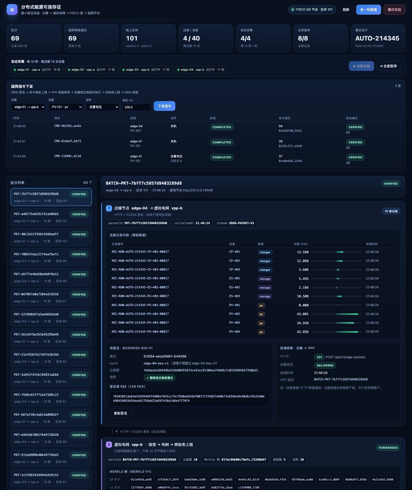
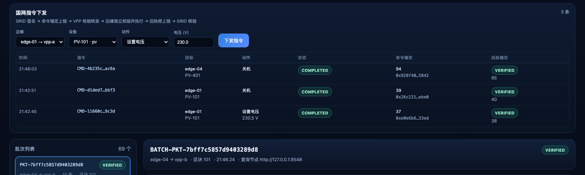
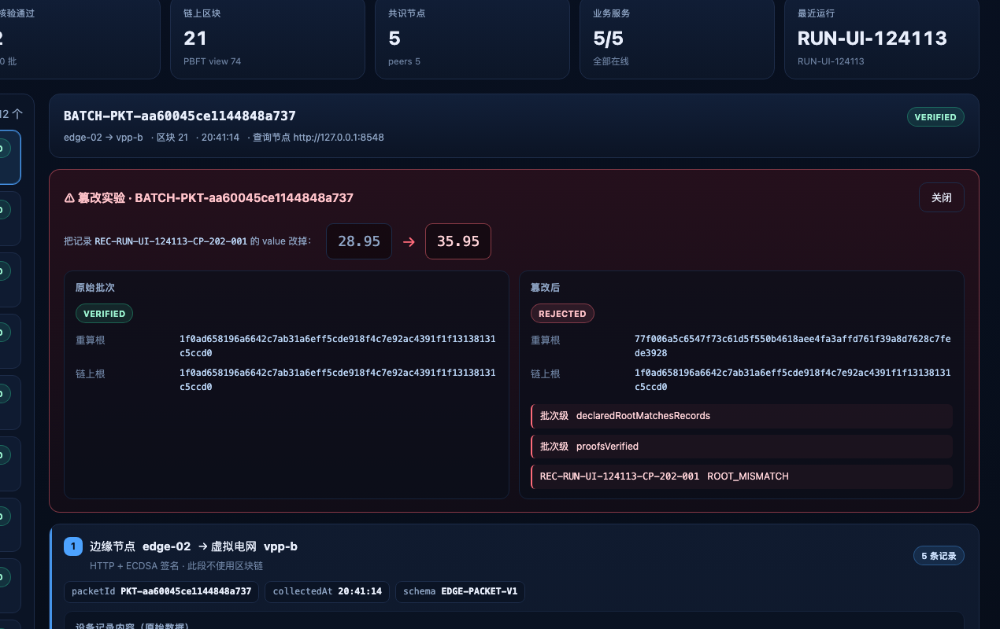

# 分布式能源可信存证 —— 研究生A 最小验证实验

仓库：<https://github.com/elderKnife/QKL>

本目录实现《研究生A开发任务书 v1.0》要求的最小闭环验证，**只覆盖本次明确要求的范围**：

| 项 | 本实验的实现 |
|---|---|
| 边缘节点 | **4 个**：`edge-01/02 → vpp-a`，`edge-03/04 → vpp-b`（每个 VPP 两个边缘） |
| 每个边缘设备 | **10 台**（光伏 / 储能 / 充电桩混合），共 **40 台** |
| 虚拟电网（VPP） | 2 个：`vpp-a`、`vpp-b` |
| 国网平台（GRID） | 1 个：`grid` |
| 边缘 ↔ VPP | **普通 HTTP 数据通信，不使用区块链**；边缘签名、VPP 验签 |
| VPP ↔ GRID | **使用 FISCO BCOS**；只把每批记录的 **Merkle 根哈希** 上链，GRID 独立读链校验 |
| 自动采集 | **每 10 秒一轮**，每轮每边缘 10 条；面板提供「全部开始 / 全部暂停」 |
| 指令下发 | **已实现**：GRID 签名 → 命令锚定上链 → VPP 校验 → 边缘独立校验执行 → 回执根上链 → GRID 核验 |
| A1 终端（300 台设备模拟器） | 仍不引入；边缘内置 10 台设备模拟作为 A1 替身，另保留手动注入脚本 |
| 区块链网络 | FISCO BCOS 2.11.0，**5 个共识节点**（PBFT），单机 5 进程 |

## 1. 一分钟看懂数据流

```
 edge-01 (10 devices) ─┐
 edge-02 (10 devices) ─┴─ HTTP+签名（无链）─▶ vpp-a ─┐
                                                     ├─ registerBatch(root) ─▶ FISCO 5 节点
 edge-03 (10 devices) ─┐                             │                          │
 edge-04 (10 devices) ─┴─ HTTP+签名（无链）─▶ vpp-b ─┘                          │ getBatch
                                                                                ▼
 grid ◀──────────── 离线批次 + 证明 ──────────── vpp-a / vpp-b         grid 独立读链复算
   │
   └─ 指令下发：grid 签名+命令锚定 → vpp 校验 → edge 校验并执行 → 回执根上链 → grid 核验
```

关键点：

1. **边缘进程没有任何链客户端、链账户、链配置**（`tests/test_architecture.py` 自动检查）。
2. VPP 只写 `RootHashRegistry.registerBatch(batchId, root, count, ts, vppId, schemaVersion)`，
   链上**不保存原始记录**。
3. GRID 用**自己的**链客户端（node3，8548）重新读链，再与离线重算的根、逐条 Merkle 证明比对。
4. 指令方向同样“一条一锚定”：GRID 把命令根写链（`GRID-COMMAND-V1`），VPP 把边缘回执根写链（`EDGE-ACK-V1`），GRID 再读链核验。

## 2. 目录结构

```
QKL/
├── chain/                     # FISCO BCOS 部署（build_chain.sh + 5 节点配置，nodes/ 不入库）
├── contracts/                 # RootHashRegistry.sol + 编译产物
├── config/
│   ├── system.json            # 全部角色的唯一配置源
│   ├── chain.json             # 合约地址与部署证据（deploy 脚本生成）
│   └── keys/                  # 测试专用 PEM（不入库）
├── src/
│   ├── common/                # 规范化 JSON、Merkle、签名、协议校验、SQLite
│   ├── chain/                 # 链适配层（BcosClient 封装 + 合约包装）
│   ├── edge/service.py        # 边缘：10 台设备模拟、10s 采集、签名上报、执行指令（无链）
│   ├── vpp/service.py         # VPP：验签、构树、根上链、转发
│   ├── grid/service.py        # GRID：独立读链、复算、逐条证明校验
│   └── web/                   # 只读聚合面板 + 采集控制 + 指令下发入口
├── scripts/                   # 建链、起停、演示、篡改实验、证据采集
├── tests/                     # 70 个单元/架构/指令/面板测试
├── docs/                      # 需求分析、架构、协议、链证据、测试记录
└── vendor/python-sdk/         # FISCO 官方 Python SDK（Apache-2.0，含少量本地补丁）
```

## 3. 快速开始（本机已部署完成，重跑只需 3～5 步）

前置：macOS（本机为 Apple M4 / macOS 15.2）、Python 3.10、Bash 5（`/opt/homebrew/bin/bash`）、
`tools/solc`（solc 0.6.10）、`chain/bin/fisco-bcos`（FISCO BCOS 2.11.0 macOS arm64）。

```bash
cd /Users/zyd/PycharmProjects/QKL

# 1) 链（若未运行）
./scripts/start_chain.sh              # 5 个 fisco-bcos 进程，8545..8549
# 2) 合约（仅首次/重置后）
./scripts/compile_contract.sh
.venv/bin/python scripts/deploy_contract.py
# 3) 八个服务（4 边缘 + 2 VPP + grid + web）
./scripts/start_services.sh
# 4) 端到端演示（1 轮 × 4 边缘 = 4 个批次）
.venv/bin/python scripts/demo_flow.py --rounds 1
# 5) 篡改实验
.venv/bin/python scripts/tamper_demo.py
# 证据：data/reports/*.json ；链证据：.venv/bin/python scripts/chain_evidence.py
```

启动后打开浏览器：

**http://127.0.0.1:8400** —— 可视化面板。自动采集默认是**暂停**的，
打开页面后点「▶ 全部开始」即可每 10 秒看到 4 个边缘各上报 10 条记录。

停止：`./scripts/stop_services.sh`、`./scripts/stop_chain.sh`。
本地状态归档重置：`./scripts/reset_local_state.sh`（**不删除链上或历史证据**）。

### 在另一台电脑上从零运行

仓库不含私钥、链节点数据、二进制与编译产物，新机器上需要 6 步：

```bash
git clone https://github.com/elderKnife/QKL.git && cd QKL
python3 -m venv .venv && .venv/bin/pip install -r requirements.txt
.venv/bin/python scripts/gen_accounts.py        # 生成测试身份并同步公钥
# 下载 chain/bin/fisco-bcos（2.11.0）与 tools/solc（0.6.10），见文档
./scripts/compile_contract.sh
/opt/homebrew/bin/bash chain/build_chain.sh -l 127.0.0.1:5 -p 30300,20200,8545 -e ./bin/fisco-bcos -o ./nodes
./scripts/start_chain.sh && .venv/bin/python scripts/deploy_contract.py
./scripts/start_services.sh                      # 打开 http://127.0.0.1:8400
```

完整的分平台步骤、下载地址、常见问题见
**[docs/07-在其他电脑上运行.md](docs/07-在其他电脑上运行.md)**。

### 端口表

| 角色 | 端口 | 说明 |
|---|---|---|
| edge-01..04 | 8101–8104 | 设备采集、包状态、指令执行 |
| vpp-a / vpp-b | 8201 / 8202 | 接收边缘包、链上存证、转发 GRID |
| grid | 8301 | 独立核验、链上批次查询 |
| web 面板 | 8400 | 只读聚合可视化（记录、签名、Merkle、链上、核验） |
| FISCO node0..4 | 8545..8549 | JSON-RPC；P2P 30300..30304；Channel 20200..20204 |

## 4. 可视化面板（新增）

打开 <http://127.0.0.1:8400>：



一条链路从上到下分四段：

1. **边缘节点**：10 条记录原始内容（型号/功率/时间）、包签名 `r‖s`、包摘要、
   面板独立验签结果、POST 到 VPP 的 HTTP 状态；**点击任意一条记录**会弹出该条记录的
   JSON 与逐字段注释、规范化字节、叶子哈希和 Merkle 证明路径；
2. **虚拟电网**：Merkle 树的每一层、根哈希、逐条证明路径、上链交易哈希与区块；
3. **FISCO 链上**：`getBatch` 的链上状态（仅根+元数据）、交易回执（status/from/to/block）、
   calldata 中可见的根；
4. **国网平台**：VPP 声明根 / GRID 重算根 / 链上读取根三方比对、9 项核验清单、
   失败记录定位与最终结论。

面板顶部还有：

- **自动采集控制**：每个边缘的运行状态（运行中/已暂停、已采集轮数），
  「全部开始 / 全部暂停」按钮；
- **国网指令下发**：选择边缘、设备、动作（设置电压 / 开机 / 关机）并下发，
  下方表格实时显示命令锚定区块、回执核验结果；
- **发一轮数据**：手动注入（等价于 `scripts/feed_records.py`）；
- **篡改实验**：选一个已核验批次，改一条记录后重新核验，红色面板展示
  `VERIFIED → REJECTED` 与失败记录（见下图）。





面板**不参与可信路径**：它只调用现有服务与链 RPC，不签名、不写库、不上链；
「开始/暂停采集」与「指令下发」只是转发调用，真正的签名与上链仍由 GRID/VPP/边缘各自完成。
接口说明见 [docs/06-Web可视化面板.md](docs/06-Web可视化面板.md)。

## 5. 本次已经验证的结论（均有可复跑证据）

| 结论 | 证据 |
|---|---|
| 5 个真实 FISCO 节点、5 个 sealer、互相连通 | `data/reports/chain-evidence.json`：每节点 `sealerCount=5`、`peerCount=5`；节点文件中的 5 个 nodeId 与 sealer 列表完全一致 |
| 合约真实部署并完成 VPP 授权 | `config/chain.json`：部署 tx `0x2b7780…` 在区块 1；VPP A/B 授权 tx 在区块 2/3 |
| 边缘 → VPP 不上链 | 边缘进程仅依赖 `vppUrl`；架构测试断言边缘进程无 `src.chain`/`bcosclient` 模块 |
| 每批只上链根哈希 | `contracts/RootHashRegistry.sol`：链上仅 `root / count / ts / vppId / schemaVersion` |
| 4 边缘 × 10 设备自动采集 | 面板 4/4 运行中，每轮每边缘 10 条记录，VPP 收到 10 条/包 |
| GRID 独立校验成功 | 4 个批次（区块 104–107）全部 `VERIFIED`，见 `data/reports/demo-RUN-MINI-001-134637.json` |
| 指令下行闭环 | 命令锚定（如区块 94）+ 回执锚定（区块 95），`status=COMPLETED`、`ackStatus=VERIFIED`；设备状态随指令变化（`power_off` 后该设备功率为 0） |
| 跨节点读到同一笔交易/同一根 | `chain-evidence.json`：node0/node3/node4 交易回执同区块；node0/node4 读到同一 `rootHash` |
| 篡改可发现且能定位到具体记录 | `data/reports/tamper-BATCH-PKT-efd23c214ca645558db6.json`：改 1 条记录 → `REJECTED`，失败清单只报该 `recordId`；伪造证明路径同样被拒 |
| 协议/密码学单元行为正确 | `.venv/bin/python -m unittest discover -s tests`：70 项全部通过 |

## 6. 设计取舍（写进报告时要说明的边界）

- **链版本**：选用 FISCO BCOS **2.11.0**，原因是官方提供 macOS arm64 原生二进制，且官方 Python SDK 可直接做结构化交易（3.x 的 Python 侧交易编码依赖 C SDK，无法在本机 arm64 原生运行）。该选择只影响链的版本，不影响本实验要验证的“根哈希上链 + 独立校验”结论。
- **5 个共识节点都在一台机器上**：符合五节点实验任务书“允许一台计算机启动五个独立进程”的边界；报告中必须写明这一局限。
- **A1 仍是替身**：边缘内置 10 台设备模拟（含指令后的开/关与电压状态），不是真实设备；A1 接入后替换采集端即可。
- **指令闭环是同步演示**：GRID 请求内完成“锚定→下发→执行→回执锚定→核验”，没有做异步任务队列与跨故障严格一次执行。
- **边缘与 VPP 之间没有 TLS/认证网关**：本机实验，仅有业务签名；跨机部署需补传输保护与认证。
- **临时数据注入**：`scripts/feed_records.py` 不是 A1，只是验证链路的替身。

更细的说明见：

- [需求分析](docs/01-需求分析.md)
- [架构设计](docs/02-架构设计.md)
- [数据协议](docs/03-数据协议.md)
- [FISCO 链部署与证据](docs/04-FISCO链部署与证据.md)
- [测试与验证记录](docs/05-测试与验证记录.md)
- [Web 可视化面板](docs/06-Web可视化面板.md)
- [在其他电脑上运行](docs/07-在其他电脑上运行.md)
