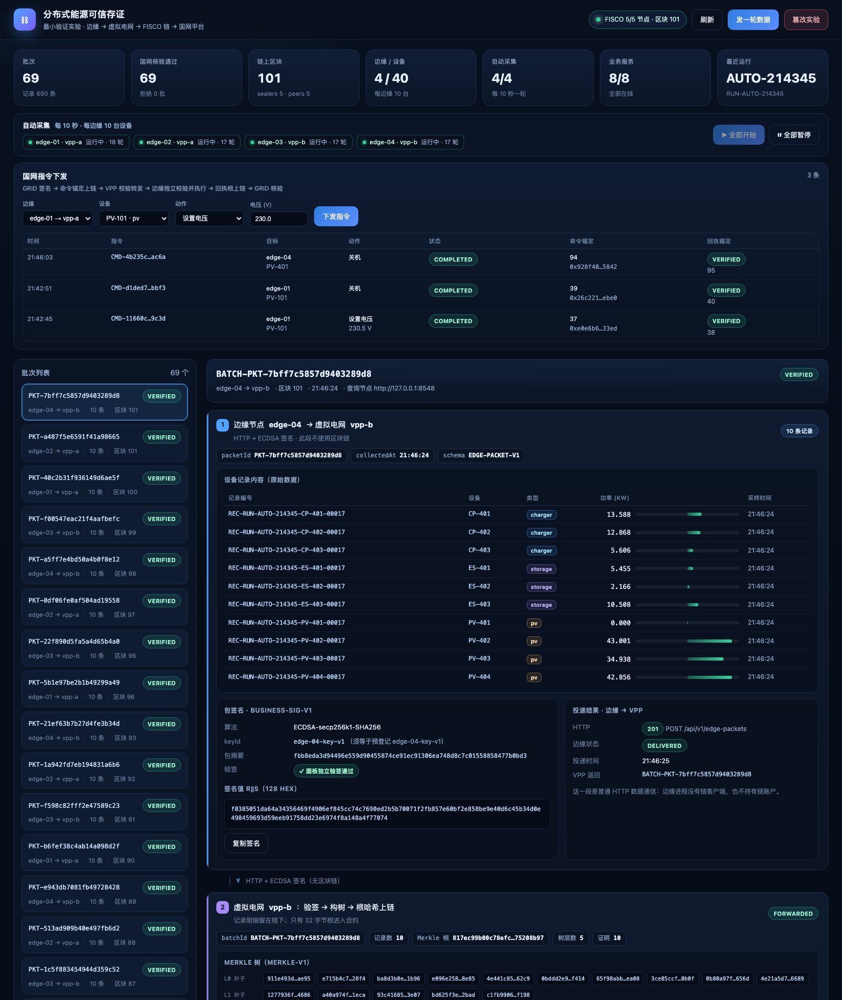
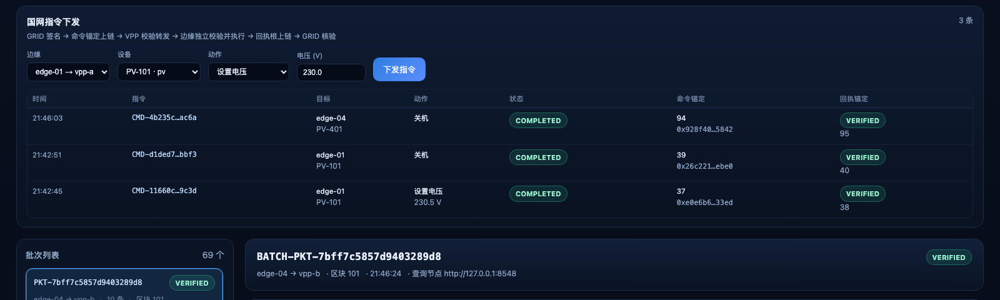
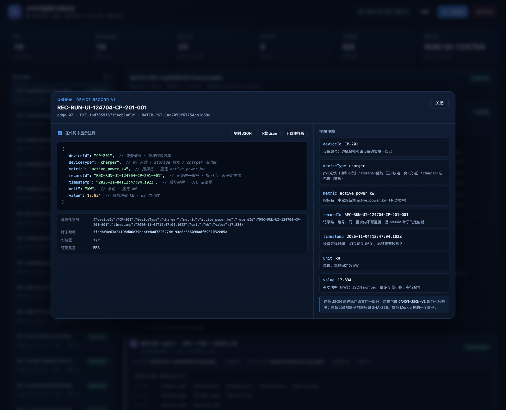
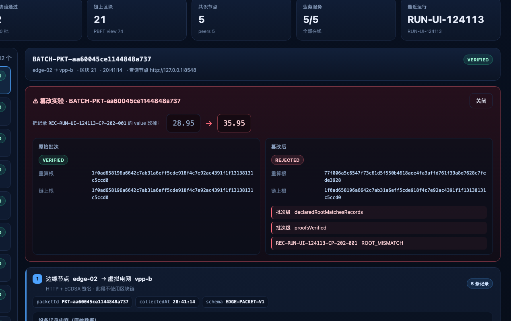

# 06 Web 可视化面板

## 1. 定位与边界

面板做两件事：**把已经发生的三段传输原样展开给人看**，并提供两个演示入口
（自动采集控制、国网指令下发）。

```
边缘 → VPP（HTTP + 签名，无链）
VPP  → 链（registerBatch，只有根）
链   → GRID（独立 getBatch + 复算 + 逐条证明）
```

它**不是**可信路径的一部分：

- 不写 VPP/GRID 业务数据库，不签名，不发链交易；
- 不改变任何业务判定：GRID 的 `VERIFIED/REJECTED` 由 GRID 自己计算，面板只展示；
- 「开始/暂停采集」「下发指令」只是转发调用，真正的签名/上链由边缘、VPP、GRID 各自完成；
- 面板宕机不影响数据链路（边缘、VPP、GRID 各自独立运行）。

## 2. 启动与访问

```bash
cd /Users/zyd/PycharmProjects/QKL
./scripts/start_services.sh      # 现在会一并启动 web（端口 8400）
```

浏览器打开：**http://127.0.0.1:8400**

- 面板每 4 秒刷新顶部统计，每 5 秒刷新批次列表；
- 选中批次的状态变化时自动刷新详情；
- 也可以通过 `scripts/stop_services.sh` 一并停止。

## 3. 页面结构



### 顶部统计 + 自动采集控制

顶部统计展示：批次/记录数、GRID 核验通过、链上区块、边缘/设备（4/40）、
自动采集运行数、服务在线数、最近运行。

其下是**自动采集控制条**：每个边缘一个状态胶囊（运行中/已暂停、已完成轮数），
右侧「全部开始 / 全部暂停」按钮会同时调用 4 个边缘的采集接口。

### 顶部统计

| 卡片 | 来源 |
|---|---|
| 批次 / 记录数 | VPP `GET /api/v1/packets` 汇总 |
| 国网核验通过 / 拒绝 | GRID `GET /api/v1/batches` 汇总 |
| 链上区块 / PBFT view | 链 RPC `getBlockNumber`、`getPbftView`（经 GRID 的 node3） |
| 共识节点 / peers | 链 RPC `getSealerList`、`getGroupPeers` |
| 业务服务在线数 | 各服务 `/healthz` |
| 最近运行 | 最新 VPP 包明细中记录编号前缀 |

### 国网指令下发面板



- 下拉选择边缘、设备、动作（设置电压 / 开机 / 关机）；
- 「下发指令」后，GRID 生成并签名命令、把命令根锚定上链，VPP 校验后转给边缘；
- 边缘独立校验、执行模拟动作、签名回执；VPP 把回执根锚定上链并转回 GRID；
- 表格实时显示命令锚定区块、回执核验结果与设备最终状态（`appliedState`）。

### 左侧批次列表

每个 VPP 收到的包一行：`packetId`、`edge → vpp`、记录数、区块、GRID 结论。
点击切换右侧详情。

### 右侧四段链路

| 段 | 展示内容 | 数据来源 |
|---|---|---|
| ① 边缘 → VPP | 10 条记录明细表（设备/类型/功率/时间）、包签名 `r‖s`、包摘要、**面板独立验签结果**、HTTP 投递状态 | 边缘 `GET /api/v1/packets/{id}` + 配置里的预登记公钥 |
| ② VPP | 验签/构树状态、Merkle 每层节点、根哈希、逐条证明路径、txHash、区块 | VPP `GET /api/v1/packets/{id}`（含 envelope/proofs） |
| ③ FISCO 链 | `getBatch` 链上记录（root/count/vppId/schema/ts）、交易回执（status/from/to/block/gas）、calldata 片段 | GRID `GET /api/v1/chain/batches/{id}` + 链 RPC `getTransactionReceipt`、`getTransactionByHash` |
| ④ 国网平台 | 三方根比对（VPP 声明 / GRID 重算 / 链上读取）、9 项核验清单、失败记录、最终结论 | GRID `GET /api/v1/batches/{id}` |

### 记录 JSON 明细

点击「设备记录内容」表格里的任意一行，会弹出该条记录的 JSON：



弹窗包含：

- **左侧 JSON 代码**：与边缘包原文完全一致；勾选「在代码中显示注释」后，
  每个字段行尾会追加该字段的简短注释（用 `//` 标出，属于展示层，不影响 JSON 本身）；
- **右侧字段注释**：7 个字段逐个给出取值与含义/约束；
- **密码学定位**：`CANON-JSON-V1` 规范化字节、叶子哈希（SHA-256 + 叶子前缀）、
  在 Merkle 树中的位置（第几条 / 总条数）、证明路径（L/R 序列）；
- **操作**：复制 JSON、下载 `.json`、下载带注释的 `.jsonc`（注释只存在于下载文本中）。

同一批次的记录按 `(deviceId, timestamp, recordId)` 排序后编叶子，所以“树位置”
不是表格里的显示顺序，而是 Merkle 叶子下标。

也可以用链接直接打开：

```
http://127.0.0.1:8400/?record=first          # 打开当前批次第一条记录
http://127.0.0.1:8400/?record=REC-...-001    # 按记录编号打开
```

### 篡改实验

点击右上角「篡改实验」（或打开 `http://127.0.0.1:8400/?tamper=1` 自动触发）：



面板会选一个 `VERIFIED` 批次，把其中一条记录的 `value` 加上 7.0，
保留原证明提交给 GRID 的 `POST /api/v1/verify`，展示：

- 原始批次：`VERIFIED`；
- 篡改后：`REJECTED`；
- 两份根：GRID 重算根已变化，链上根保持不变；
- 失败清单：精确到被改的 `recordId`。

## 4. 面板后端接口

| 方法 | 路径 | 说明 |
|---|---|---|
| GET | `/` | 单页页面 |
| GET | `/healthz` | 面板自身健康 |
| GET | `/api/overview` | 链状态、服务健康、批次统计 |
| GET | `/api/batches` | 合并后的批次列表（VPP + GRID + 边缘投递状态） |
| GET | `/api/batches/{batchId}` | 单批次四段详情（含 Merkle 各层、三方根、回执） |
| POST | `/api/feed` | `{"rounds":1}`，调用 A1 替身给 4 个边缘各注入 10 条记录 |
| POST | `/api/tamper` | 自动选批次、篡改一条记录并调用 GRID 复核 |
| GET | `/api/collection` | 4 个边缘的采集状态（运行中、周期、轮数） |
| POST | `/api/collection/start` | 让 4 个边缘开始 10 秒采集 |
| POST | `/api/collection/pause` | 暂停所有边缘采集 |
| GET | `/api/meta` | 边缘/设备/动作下拉选项 |
| GET | `/api/commands` | GRID 指令列表（含锚定区块、回执状态） |
| POST | `/api/commands` | 创建并下发指令（代理 GRID） |

`POST /api/tamper` 不会修改已存证数据，也不会写库；它只调用 GRID 的
`/api/v1/verify` 诊断接口，因此原始证据保持不变。

## 5. 安全与限制

1. 只监听 `127.0.0.1:8400`，没有登录/鉴权，**仅供本机实验**；
   跨机部署前必须加认证与 TLS，或改为只读静态导出。
2. 面板依赖五个服务同时在线；任一服务宕机时对应卡片显示离线/空值，不影响其他部分。
3. `/api/tamper` 与 `/api/commands` 是演示入口，生产中应加认证、限流与审计。
4. 统计数字来自各服务当前状态，不做历史归档；历史证据仍以 `data/reports/*.json` 为准。

## 6. 实现位置

| 文件 | 作用 |
|---|---|
| `src/web/service.py` | Flask 聚合后端（只读 HTTP 客户端 + 链 RPC） |
| `src/web/static/index.html` | 页面骨架 |
| `src/web/static/styles.css` | 深色主题样式 |
| `src/web/static/app.js` | 渲染、轮询、复制、发数据、篡改实验 |
